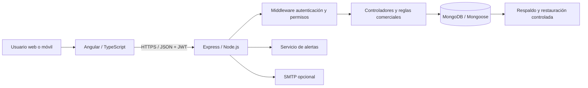

# Arquitectura del sistema

## Componentes

## Límites y reglas

- Angular **no** se conecta directamente a MongoDB: consume la API REST.
- Los permisos se aplican en el backend; ocultar botones no sustituye la autorización.
- Una cotización aceptada debe preservar importes aprobados; no recalcular con el catálogo.
- Las operaciones de inventario, documentos y pagos relacionadas requieren transacciones y pruebas de concurrencia.
- MongoDB debe operar en replica set para transacciones multi-documento.
- Los cambios de esquemas requieren una migración planificada y copia de seguridad.

## Deuda técnica conocida

- Auditar los `catch` de cada controlador: algunos responden 500 directamente y no usan el middleware central.
- Revisar idempotencia de reembolsos, devoluciones y cobros externos.
- Conciliar inventario global con existencias por bodega antes de activar operación multibodega.
- Verificar la configuración CORS por ambiente y el manejo de tokens en el navegador.
- No se han ejecutado pruebas funcionales ni de integración en esta fase.
